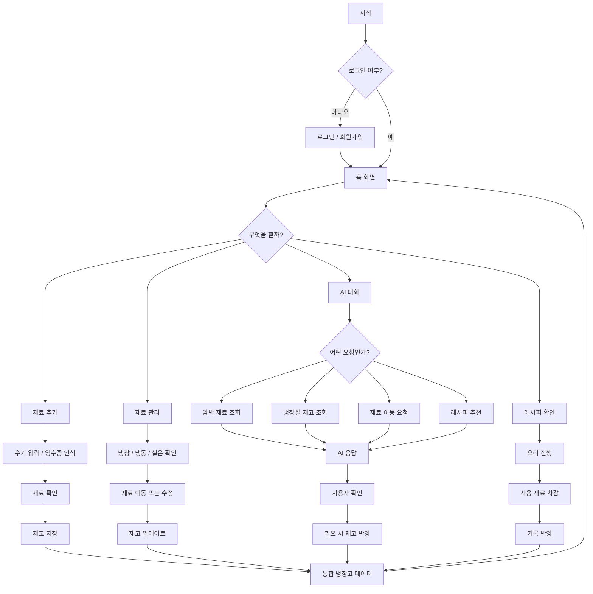

# AI 스마트 냉장고 관리 웹앱 — Claude Code 프로젝트 가이드

> 이 파일을 프로젝트 최상위 디렉터리에 `CLAUDE.md`로 둔다. Claude Code는 작업 전 이 문서를 읽고 요구사항과 실제 코드 상태를 비교한다.
> **문서의 기능은 기획 요구사항이며 이미 구현되었다는 뜻이 아니다.** 실제 구현 여부는 코드와 실행 결과를 통해 검증한다.

## 1. 프로젝트 개요

- **목표:** 사용자가 보유 식재료를 냉장·냉동·실온별로 등록·관리하고, 표시된 소비기한 및 보관 상태를 추적하며, AI 대화와 레시피 추천을 통해 음식물 낭비를 줄이는 반응형 웹앱을 만든다.
- **핵심 사용 흐름:** 식재료 등록 → 재고 관리 → AI 조회·분석 → 레시피 활용 → 실제 사용량 차감 → 기록·관리 성과 확인.
- **원칙:** 화면 간 데이터는 하나의 재고 데이터 소스를 공유한다. 동작하지 않는 버튼이나 가짜 성공 메시지를 만들지 않는다.
- **기존 스케치/Figma 시안이 있다면:** 해당 화면 배치와 이동 흐름을 우선 존중하되, 한 페이지에 모든 기능을 몰아넣지 않는다.
- **언어:** 기본 UI는 한국어. 언어 변경은 확장 기능.

## 2. Claude Code 작업 원칙

1. **먼저 저장소 조사:** 패키지 매니저, 프레임워크, 라우터, 상태 관리, DB, 인증, 스타일, 테스트 도구를 확인하고 기존 구현을 재사용한다. **기술 스택을 임의로 교체하거나 전체 프로젝트를 재생성하지 않는다.**
2. 작업 시작 전에 변경 범위와 필요한 파일을 짧게 설명한다. 기능을 작은 단위로 구현하고 빌드·테스트한다.
3. UI 컴포넌트와 비즈니스 로직, DB 접근, AI/OCR 연동은 분리한다. 타입과 데이터 검증을 사용한다.
4. API 키와 비밀값은 서버 환경 변수로만 관리하고 클라이언트 코드·Git에 노출하지 않는다. `.env.example`에는 변수 이름만 기재한다.
5. **외부 연동이 준비되지 않았다면:** 인터페이스와 개발용 mock을 명확하게 구분한다. OCR 또는 AI가 실제로 동작하는 척하지 않는다.
6. 삭제·대량 변경·AI의 재고 수정은 사용자 확인과 가능한 경우 되돌리기를 제공한다.
7. 접근성(키보드 조작, 명확한 라벨, 색상 이외의 상태 표기)과 모바일 반응형을 고려한다.
8. 프로젝트에 실제 파일이 있다면 이 문서와 상충하는 부분을 보고하고, 확인이 필요한 요구사항을 질문한다.
9. 매 작업 완료 시 구현 내역, 수정한 파일, 테스트 결과, 남은 이슈를 요약한다.

## 3. 디자인 시스템

### 기본 브랜드 색상

| 색상 | HEX | 권장 용도 |
| --- | --- | --- |
| 매우 연한 핑크 | `#FBEFEF` | 페이지 배경 |
| 연한 핑크 | `#FFE2E2` | 카드, 보조 배경 |
| 피치 핑크 | `#F5CBCB` | 선택/강조 UI |
| 라벤더 | `#C5B3D3` | AI·핵심 버튼, 포인트 |

- 미니멀하고 따뜻한 파스텔 느낌. 흰색·중립색을 충분히 사용하여 복잡하지 않게 만든다.
- 상태 안내용 위험/경고/정보 색상은 별도 의미 색상 사용 가능. 텍스트·아이콘도 함께 표시한다.
- 카드·모달은 둥근 모서리와 적당한 여백. 동일한 UI 요소는 재사용 가능한 컴포넌트로 만든다.
- **모바일:** 하단 내비게이션 권장. **PC:** 사이드바 또는 일관된 상단 내비게이션 권장.

## 4. 정보 구조 및 주요 화면

메인 화면은 아래처럼 구분하며 각 기능은 전용 화면/서브화면/모달로 연결한다.

1. **홈 대시보드:** 환영 메시지, 오늘의 냉장고 상태, 임박 재료 3~5개, 보관 장소별 재고 요약, 오늘의 추천 요리, 빠른 작업, 관리 성과 요약. 전체 목록은 해당 화면으로 연결.
2. **재료 관리:** 냉장/냉동/실온 탭, 재료 카드/목록 전환, 검색, 카테고리 필터, 정렬, 묶어보기, 상세 보기, 다중 선택·삭제, 재료 이동.
3. **대화형 AI:** 재고 기반 질문·답변, 임박 재료/보관 장소별 조회, 보관 방법 안내, 재료 추가/수정/이동 확인, 레시피 추천, 대화 이력.
4. **레시피:** AI 레시피와 유튜브 레시피 구분, 필터, 상세 조리 단계, 즐겨찾기, 사용 재료 차감.
5. **게이미피케이션:** 냉장고 상태 신호등, 관리 점수, 포인트/레벨, 미션·배지, 주간 리포트.
6. **재료 추가:** 수기 입력, 자연어로 추가, 영수증 이미지 OCR(파일 업로드; 모바일 촬영 지원 검토).
7. **설정:** 연결 계정, 프로필, 알림, 언어/테마, 데이터 관리, 도움말/지원, 문의, 업데이트 노트, 개인정보 처리방침, 이용약관, 버전, 로그아웃, 탈퇴.

> 게이미피케이션은 홈에서 바로 진입할 수 있게 구성하며, 모든 화면을 하단 탭에 강제로 포함할 필요는 없다.

## 5. 사용자 플로우(합의된 간략 플로우차트 기준)



**중요:** 마지막 레시피 단계의 명칭은 사용자가 지정한 대로 **`기록 반영`**이며 `기록 / 포인트 반영`이 아니다. 게이미피케이션 포인트 계산은 별도 연동 가능하지만 이 단계의 UI 명칭을 변경하지 않는다.

## 6. 기능 요구사항 및 수락 기준

### 6.1 재료 등록

- 수기 입력 필수값: **재료명, 수량, 단위, 보관 장소**. 선택값: 카테고리, 구매일, 등록일(기본 자동), 포장 표시 기한·유형, 가격, 사진, 메모.
- AI 자연어 입력 예: `계란 10개, 우유 1L, 양파 3개 추가해줘` → 항목·수량·단위 파싱 → 미리보기·수정 → 승인 후 저장.
- 영수증: 이미지 업로드/촬영 → OCR 텍스트 인식 → 상품명·수량·가격·구매일 추출 → 식재료 외 상품 제외/표준화 → 사용자 수정 및 선택 → 저장.
- **OCR 결과는 반드시 확인 가능해야 한다.** 사진만으로 소비기한을 추측해서 확정 기한으로 저장하지 않는다.
- 동일 재료라도 구매 회차/소비기한/보관 장소가 다르면 독립 재고 항목(로트)으로 유지할 수 있게 한다. 합치기는 사용자 선택.
- 실패/빈 입력/중복/로딩/권한 거부 시나리오 구현.

### 6.2 재료 목록·상세·관리

- 냉장·냉동·실온 탭, 카테고리(채소, 과일, 육류, 수산물, 달걀·유제품, 곡류, 버섯, 양념·소스, 가공식품, 음료, 기타), 검색, 필터, 정렬(기한 임박/최근 등록/이름/수량), 묶어보기.
- 카드·목록 보기 지원. 상세에서 이름·수량·보관 장소·기한·이력 확인 및 수정/사용/삭제.
- 다중 선택 후 일괄 삭제, 가능한 경우 복구/되돌리기. 삭제 확인 절차.
- 부분 소비/부분 이동: 예) 대파 3단 중 2단 냉동, 1단 냉장 유지.
- 저장·수정·이동·소비 후 홈/AI/레시피/통계에 변경 사항이 일관되게 반영된다.

### 6.3 드래그 앤 드롭 보관 장소 이동

- PC 드래그, 모바일 길게 누른 후 드래그 지원 검토. 별도 **`보관 장소 변경`** 버튼도 제공.
- 대상: 냉장↔냉동, 냉장/냉동↔실온(재료에 따라 부적절한 이동 경고).
- 드롭 즉시 DB 수정 **금지** → 보관/해동 방법, 상태 확인, 예상 품질 유지 기간 안내 → 사용자 승인 → 이동 및 이동 이력 저장.
- 수량 일부 이동과 취소/되돌리기 고려.
- **냉동했음을 이유로 원래 포장의 소비기한을 자동 연장하지 않는다.** 참고용 예상 보관 기간은 별도 데이터로 저장.

### 6.4 AI 대화 — 실제 재고 연동 필수

AI는 실제 재고를 조회해 답변한다. 단순히 완료했다고 말하지 않으며 수정 API 성공을 확인한 뒤 성공 메시지를 보낸다.

**대화 의도 및 동작**

| 사용자 의도 | 동작 |
| --- | --- |
| `유통기한/소비기한 얼마 안 남은 재료 알려줘` | 실제 표시 기한 기준 임박 순 조회, 날짜·수량·보관 위치 표기, 활용 레시피 제안 |
| `냉장실에 뭐 있어?` | 냉장실 재고 이름/수량/카테고리/기한 요약. 바로 응답 |
| `냉동실에 뭐 있어?` | 냉동 재고 및 냉동 날짜·예상 품질 유지 기간 조회 |
| `실온에 뭐 있어?` | 실온 재고 조회, 부적절한 보관은 주의 안내 |
| `냉장고 정보 알려줘` | 임박/냉장/냉동/실온/카테고리/전체 중 무엇을 볼지 **한 번 더 질문** |
| `대파 냉동실로 옮겨줘` | 대상 로트·수량 파악 → 냉동 방법·예상 기간 설명 → 승인 → 실제 이동 |
| `두부로 만들 요리 추천해줘` | 보유·임박 재료 우선, 부족한 재료/조리 시간 포함 추천 |
| `양파 3개가 아니라 2개야` | 변경 대상 확인 → 변경 미리보기 → 승인 후 실제 수량 수정 |
| `계란 10개 추가해줘` | 파싱 → 미리보기 → 승인 후 재고 등록 |

- 모호한 재료명/동일 이름의 복수 로트/수량 불명 시 명확히 질문한다.
- 조회만 하는 질문에는 불필요한 승인 단계를 강요하지 않는다. **재고 변경 작업만 승인 필수**.
- 대화에 빠른 선택 버튼(예: 임박 재료, 냉장실, 냉동실, 실온, 카테고리별, 전체 보기) 제공.
- AI 레시피는 보유 재료 기반, 소비기한이 가까운 재료 우선, 보유율/부족한 재료/조리 시간/난이도 표시.
- 대화 로그는 사용자별 접근 권한과 개인정보 기준을 따름.

### 6.5 레시피

- **AI 레시피** / **유튜브 레시피** 탭 분리.
- 조리 시간, 난이도, 음식 종류, 인분 수 필터. 알레르기/기피 재료/식단 선호는 선택 확장.
- 상세: 이름, 사진(있는 경우), 예상 시간, 인분, 보유·부족 재료, 단계별 조리법, 즐겨찾기. 부족 재료는 장보기 목록 연결(확장).
- 유튜브는 공식 API 등 정식 방식으로 검색/원본 이동. 실제 연동 없이 영상을 검색했다고 주장하지 않음.
- **요리 완료 → 사용 재료 및 실제 사용량 사용자 확인 → 해당 로트 수량 차감 → 사용 기록 저장.** 재고 부족·중복 차감 방지.
- 레시피 플로우 마지막 단계 표시 문구는 **`기록 반영`**.

### 6.6 소비기한·알림·식품 안전

- 데이터상 포장 표시 **소비기한과 유통기한을 서로 다른 유형으로 보관**, AI 추정 보관 기간은 별도 필드로 관리.
- 상태 예시: 오늘까지, D-1~3, D-4~7, 기한 경과, 미등록/확인 필요. 기준은 설정 가능하도록 설계.
- 알림: N일 전, 당일, 기한 경과, 정기 재고 점검(동의 및 설정을 따른다).
- **기한 날짜만으로 안전한 식품/위험한 식품을 확정 판정하지 않는다.** 온도·보관 이력·제품 상태 정보가 없을 수 있음을 명시한다.
- 냉장→냉동 이동은 예상 품질 유지 기간을 참고 안내할 수 있지만 제품의 원래 표시 기한을 덮어쓰지 않음. 해동 이력 기록 권장.
- 적정 보관 온도를 센서 없이 실제로 측정했다고 주장하지 않는다.

### 6.7 게이미피케이션 및 기록

- 신호등: **빨간불** 확인 시급/기한 경과, **노란불** 임박, **파란불** 현재 등록 정보상 여유. 색상 외 텍스트도 표시.
- 재고·소비 기록 기반 관리 점수(0~100), 포인트/레벨, 미션/배지, 주간 리포트(등록·사용·폐기 건수, 임박 재료 활용).
- 포인트 예시(조정 가능): 재료 등록 +5, 임박 재료 활용 +20, 소비 기록 +10, 요리 완료 +15, 주간 점검 +30.
- 악용 방지: 중복 기록·반복 등록/삭제로 점수 무한 적립 방지.
- 폐기 감소·절약액 등은 데이터가 있을 때만 계산. 실제 근거 없는 절약액 노출 금지.
- 레시피 플로우의 **`기록 반영`**과 게이미피케이션 보상 산정은 개념적으로 분리한다.

### 6.8 설정 및 계정

- 연결된 계정, 프로필, 알림 종류/시간/빈도, 언어, 테마, 접근성, 백업/내보내기(확장), 도움말, 업데이트 노트, 문의, 개인정보 처리방침, 약관, 버전, 로그아웃, 회원 탈퇴.
- 회원 탈퇴는 확인 절차와 데이터 처리 안내를 포함한다.
- 향후 공동 냉장고(사용자 초대·권한·변경 이력) 확장 고려.

## 7. 데이터 모델 요구사항(개념 모델; 기존 DB에 맞춰 구체화)

최소한 다음 엔터티를 고려한다.

- `User`: 계정 식별자, 프로필, 설정.
- `Fridge` 또는 `Household`: 냉장고/공동 그룹, 소유자 및 접근 권한.
- `IngredientLot`: **개별 구매·보관 단위** ID, 재료명/표준명, 카테고리, 수량, 단위, 보관 장소(`fridge|freezer|pantry`), 구매일, 등록일, 포장 기한, 기한 유형(`use_by|best_before|sell_by|unknown` 등 실제 요구에 맞게), 추정 보관 기간, 추정값의 출처, 메모, 상태.
- `InventoryEvent`: 재료 추가/수정/부분 이동/수량 차감/삭제/복원 이벤트, 변경 전후 값, 날짜, 실행 주체. 보관 장소 이동 시 원래 로트와 파생 로트 관계를 기록.
- `OCRScan`: 업로드 참조, 원본 텍스트, 인식 후보, 사용자 승인 상태.
- `ChatSession` / `ChatMessage`: 요청/응답/작업 제안·승인·실행 결과.
- `Recipe` / `RecipeIngredient` / `RecipeUsage`: 레시피·필요 재료·실제 사용량.
- `NotificationPreference` / `Notification`: 규칙·전송 상태.
- `GamificationEvent` / `Badge` / `Mission`: 중복 방지 가능한 포인트 이벤트 및 성취.

**데이터 불변식**

- 수량은 유효한 양수 또는 소진 상태이며 음수로 내려가지 않는다. 부분 차감/이동 시 총량이 보존된다.
- 동일 재료명이라고 다른 소비기한의 로트를 임의로 합치지 않는다.
- 수정·차감·이동은 서버에서 인증/인가·데이터 검증·동시성 충돌 방지를 수행한다.
- `사용자 승인`과 `실제 성공`을 구분해 기록한다.
- 포장 표시 기한은 참고 기한 재계산 시에도 원본으로 보존한다.

## 8. 사용자 경험 및 예외 상황

- 재고가 없는 상태: 재료 추가 CTA와 예시 안내.
- 기한 정보 없음: `소비기한 미등록` 표시. 임의의 날짜를 확정값처럼 표시하지 않음.
- AI/OCR 실패: 재시도와 수기 편집 경로 제공.
- 중복 품목/애매한 사용자 지시: 항목 선택 또는 확인 질문.
- 로그인 만료/권한 부족/네트워크 오류/업데이트 충돌: 데이터 유실 없이 안내.
- 식재료 이동이나 삭제 전에 변경 내용 미리보기, 취소 수단 제공.
- 로딩/성공/실패 상태를 분명하게 구분한다.

## 9. 개발 단계(MVP 우선)

### 1단계 — 실제 재고 관리 기반
- [ ] 기존 저장소·화면·데이터 구조 점검
- [ ] 인증 및 사용자별 데이터 접근(프로젝트 범위에 맞게)
- [ ] 재료 수기 추가/목록/상세/수정/삭제
- [ ] 냉장·냉동·실온 분류, 카테고리·검색·정렬
- [ ] 소비기한 표시/상태 구분, 새로고침 후 데이터 유지

### 2단계 — 재고 이동과 OCR
- [ ] 보관 장소 이동(버튼 우선, 그다음 드래그 앤 드롭)
- [ ] 부분 이동, 이동 기록, 사용자 확인, 예상 보관 기간 안내
- [ ] 영수증 업로드/OCR/인식 내용 수정/선택 저장

### 3단계 — AI와 레시피 연동
- [ ] AI 실제 재고 조회(임박/냉장/냉동/실온/카테고리)
- [ ] AI 재료 추가/수정/이동 제안 및 승인 후 실행
- [ ] 보유·임박 재료 기반 레시피 추천 및 상세 화면
- [ ] 요리 완료 → 사용 재료 차감 → `기록 반영`
- [ ] 유튜브 레시피 연동(키·정책 확보 후)

### 4단계 — 유지·확장
- [ ] 알림 기능
- [ ] 게이미피케이션 신호등·주간 리포트·포인트/배지
- [ ] 설정·언어·테마·지원 메뉴
- [ ] 공동 냉장고, 장보기 목록, 식단 개인화 등 확장

## 10. 테스트 체크리스트

- [ ] 재료 등록 직후 홈·재료 관리·AI 조회에서 같은 값이 보이는가?
- [ ] 새로고침 후 저장 내용이 유지되는가?
- [ ] 동일 재료를 다른 구매일/기한으로 따로 등록할 수 있는가?
- [ ] 냉장 대파 3단 중 2단만 냉동하면 양쪽 수량이 정확한가?
- [ ] 이동 취소 시 데이터가 바뀌지 않는가?
- [ ] 재료 이동 시 원래 포장 소비기한이 보존되는가?
- [ ] AI가 모호한 요청을 확인하고, 실제 실행 성공 시에만 완료를 알리는가?
- [ ] 냉장실·임박 재료 조회가 실제 DB 결과와 일치하는가?
- [ ] 영수증 OCR 오인식을 수정 후 저장할 수 있는가?
- [ ] 요리 완료 시 선택한 실제 재료 수량만 차감되는가?
- [ ] 중복 클릭·재시도 시 이중 차감/포인트 중복이 방지되는가?
- [ ] 모바일·PC와 키보드 이용 시 화면 탐색이 가능한가?
- [ ] '기록 반영' 문구가 레시피 완료 단계에서 정확히 쓰이는가?

## 11. 구현 요청용 시작 프롬프트(Claude Code에 입력)

```text
프로젝트 루트의 CLAUDE.md를 먼저 읽고, 현재 저장소의 기술 스택·폴더 구조·기존 화면·데이터 모델을 확인해 주세요.
기획 요구사항 중 구현된 기능과 미구현 기능을 표로 정리하고, 기존 스케치/Figma 디자인이 있다면 가능한 범위에서 반영해 주세요.
우선 1단계 MVP(수기 재료 등록, 냉장/냉동/실온별 재고 목록, 카테고리, 수정/삭제, 소비기한 표시, 데이터 영속화)부터 실제 동작하도록 구현해 주세요.
기존 코드를 지우거나 기술 스택을 바꾸지 말고, 필요한 변경을 작은 작업으로 진행해 주세요.
모든 주요 버튼이 작동하도록 구현하고 빌드/테스트를 실행한 다음 수정 파일과 검증 결과, 남은 작업을 알려 주세요.
AI/OCR API가 아직 연결되지 않았다면 실제 연동인 것처럼 표시하지 말고 연결 지점만 명확하게 만들어 주세요.
```

---

**범위 유의:** 실제 DB·인증·OCR·AI·알림 제공자, 배포 환경 등은 아직 정해지지 않았다. 프로젝트 코드 확인 전 특정 벤더(Supabase, Firebase 등), 프레임워크(React/Next.js 등), 인증 방식을 확정하거나 존재한다고 가정하지 않는다.
